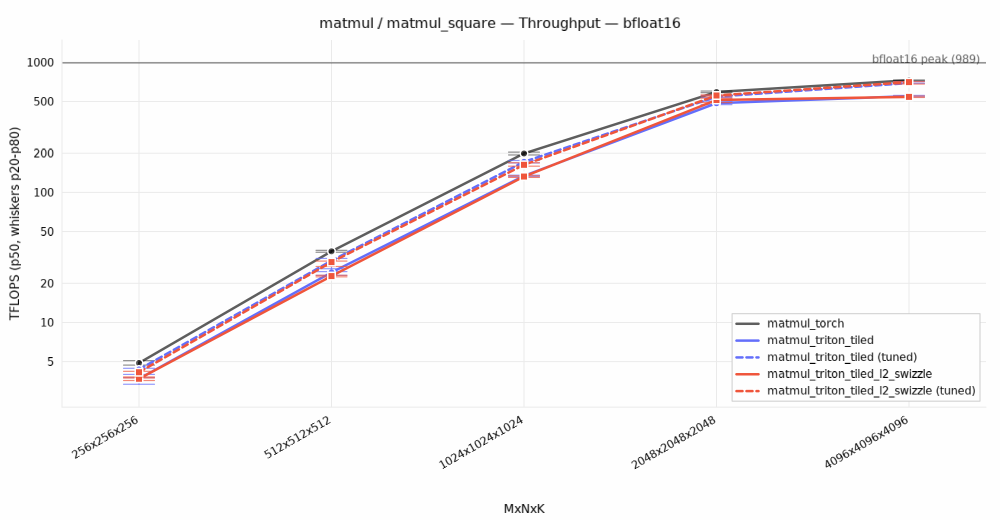
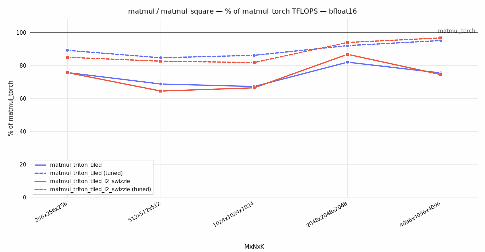
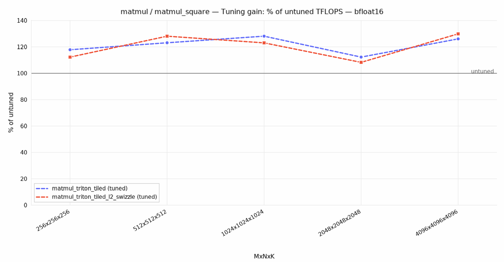
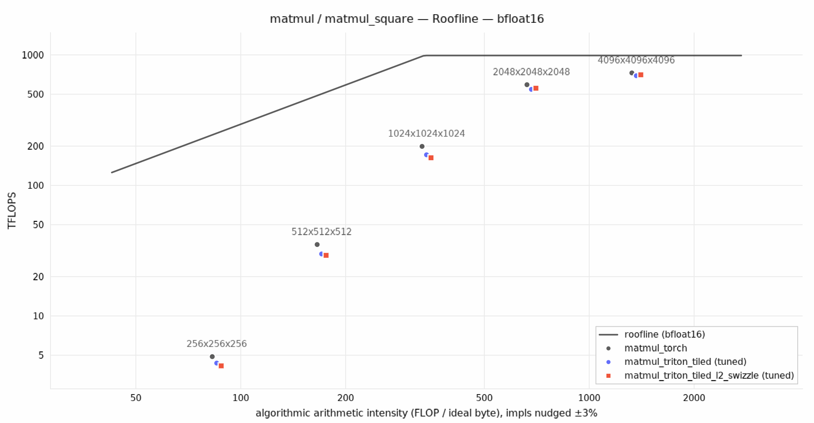

# `Kompass`

[](https://github.com/RPegoud/kompass/actions/workflows/ci.yml)
[](LICENSE)
[](https://python.org)

<a href="Kompass.png?raw=true"></a>

**Kompass is a tooling suite for GPU kernel development.** It gives you one harness to
**test, benchmark, tune and profile** CUDA, Triton and PyTorch implementations of the same
operation side by side, and to turn the results into a report. Runs can happen on your local GPU, or fan
out over many cloud GPUs in parallel through [Modal](https://modal.com).

You describe an **Op** once (how to build inputs, a reference result, a correctness check,
and FLOP/byte counts). You then register any number of **implementations** of it. 

Kompass:
- **Runs in parallel on Modal**: `bench` gives each sweep its own GPU, and `tune` splits its search into one job
  per kernel, precision and shape, spread over as many GPUs as your plan allows, with a live progress row per GPU.
  Tuning two matmul sweeps (23k configs) takes about 7 minutes on 10 H100s.
- **JIT-compiles** CUDA extensions per GPU architecture and source hash, and imports Triton kernels lazily.
- **Gates every benchmark on correctness**: a kernel whose output doesn't match the reference is never timed.
- **Sweeps** parameter grids from a YAML file and records each case's status (`ok`, `incorrect`, `oom`, `skipped_oom`, `failed`).
- **Measures copy bandwidth** on the target GPU, so results can be compared against an achievable roofline.
- **Tunes** each kernel's launch parameters (block sizes, warps, stages, ...) per GPU and problem shape, and
  benchmarks with the best config found, or with and without it side by side.
- **Reports** each sweep as plots (throughput, % of ceiling, % of baseline, roofline, tuning gain) and a results
  table, judging every case against the vendor peak of the arithmetic it runs.
- **Profiles** a single case under Nsight Compute and turns the `.ncu-rep` into flat JSONL records.
- Stamps every run with the git commit (`-dirty` if there are uncommitted changes) and the GPU, driver and CUDA versions, so results stay reproducible.

---

## 📊 Results on an H100

> [!NOTE]
> **All of this ran in parallel on 10 Modal H100s.** `kompass tune` searched 23,328 configs across the two matmul
> sweeps (8,344 pruned before compiling, the rest compiled and timed) in about 7 minutes, for about $4.
> Each benchmark run then took about a minute.

Two Triton matmul kernels, a tiled one and the same with an L2-cache swizzle, against torch (cuBLAS).
Each was tuned with `kompass tune`, then benchmarked with its default and tuned configs side by side
(`kompass bench --tuning both`) on a Modal H100 (SXM, 80GB HBM3). Throughput uses the median time of
`triton.testing.do_bench`.

| 4096³ | torch | Triton tiled, default config | Triton tiled, tuned | Tuned vs torch |
| --- | ---: | ---: | ---: | ---: |
| bfloat16 | 728 TFLOPS | 549 TFLOPS | 693 TFLOPS | 95% |
| tf32 | 372 TFLOPS | 81 TFLOPS | 153 TFLOPS | 41% |
| float32 (IEEE) | 52 TFLOPS | 0.7 TFLOPS | 30.7 TFLOPS | 59% |

- **Tuning** speeds the kernel up by 26% in bf16 and 89% in tf32. In IEEE fp32, which runs on CUDA cores rather than
  tensor cores, the default 128×128×64 tiles with 8 warps run out of registers: the tuned config is 44× faster.
- **The L2-cache swizzle doesn't pay off here.** Over 36 tuned shapes, the swizzled kernel reaches 94% of the plain
  tiled kernel's throughput on average. At these sizes, the working set fits in the H100's 50 MB L2, and the plain
  kernel's 2D launch already walks down M, so neighbouring blocks share tiles of the right-hand matrix.
- **tf32 has the most room left**: 41% of cuBLAS. Persistent kernels, warp specialization and TMA are the next steps.

The bfloat16 square sweep, as `kompass report` draws it:

<p>
  
  
</p>
<p>
  
  
</p>

---

## ⌨️ CLI endpoints

After `uv sync`, all endpoints are available through the `kompass` entry point.

| Command | What it does |
| --- | --- |
| `kompass list` | Prints every registered Op and its implementations. |
| `kompass runs [--op <op>] [--config <config_name>] [--n 20]` | Lists the most recent runs in `logs/`. |
| `kompass bench <config_name> [<config_name> ...] [--backend local\|modal:<gpu>] [--device cuda:0] [--tuning tuned\|untuned\|both]` | Runs one or more sweeps: each `impl × dtype × parameter set` in the YAML (from an `axes` grid or an explicit `shapes` list, see [Describe a sweep](docs/adding-a-kernel.md#-4-describe-a-sweep)) is checked for correctness, then timed with `triton.testing.do_bench`. Sweeps run one after another locally, and in parallel on Modal (one GPU each). A failed sweep doesn't stop the others; `bench` exits with code 1 if any failed. `--tuning` (default `tuned`) uses the configs saved by `tune` for the GPU it runs on; `both` also runs each tuned case with the launcher defaults, in the same run. |
| `kompass tune <config_name> [<config_name> ...] [--backend local\|modal:<gpu>]` | Searches each tunable impl's `search_space` on the sweep's cases (see [Make it tunable](docs/adding-a-kernel.md#-6-make-it-tunable)) and saves the fastest config per case to `src/kompass/tuning/<gpu>/<impl>.json`. Each config is timed briefly, then the 5 fastest per case are re-timed in full on the same GPU. On Modal, every (impl, precision, shape) group is its own input, spread over up to `max_containers` GPUs, costliest first. |
| `kompass profile <op>/<impl> -p K=V [-p K=V ...] [-o K=V ...] [--dtype float32] [--set full\|roofline\|detailed]` | Profiles one case under `ncu`, then ingests the report automatically. `-o` sets kernel options, e.g. `-o input_precision=tf32`. |
| `kompass ingest <reports/.../report.ncu-rep>` | Parses an existing Nsight Compute report into `records.jsonl` (`profile` calls this for you). |
| `kompass report [--config <config_name>] [--run-id <id>] [--gpu <name>] [--baseline <impl>]` | Builds `reports/<config_name>/`: `summary.md` (results table + embedded plots), `summary.csv`, `plots/*.png`, and every plot in one multi-page `report.pdf`. Uses the newest `bench` run of each sweep, one section per sweep (op + config), so sweeps of the same op never share an axis; each baseline defaults to the op's `torch` impl. Arithmetics that share a dtype (e.g. `float32` and `tf32`) get side-by-side panels, and tuned runs appear as `<impl> (tuned)` with a tuning-gain plot. |

### 💡 Examples

```bash
# What's available?
kompass list

# What are the 10 most recent logs for experiment `matmul_k_sweep`?  
kompass runs --op "matmul" --config "matmul_k_sweep" --n 10

# Benchmark vec_add on the local GPU
kompass bench vec_add_sweep

# Same sweep on a Modal H100
kompass bench vec_add_sweep --backend modal:h100

# Two sweeps in parallel, each on its own Modal H100
kompass bench vec_add_sweep matmul_square --backend modal:h100

# Tune the matmul kernels, then compare tuned and default configs in one run
kompass tune matmul_square matmul_k_sweep --backend modal:h100
kompass bench matmul_square --backend modal:h100 --tuning both
kompass report --config matmul_square

# Profile a single case. The key is <op>/<impl suffix>: `vec_add/triton` -> `vec_add_triton`
kompass profile vec_add/triton -p N=16777216 --dtype float32 --set full
```

> [!NOTE]
> `bench` takes the **full** impl names in the YAML (`vec_add_triton`). `profile` takes
> `op/suffix` (`vec_add/triton`) and joins the two parts with `_`.

---

## 🛠️ Setup

**Requirements:** an NVIDIA GPU with driver ≥ 580 (CUDA 13.x) for local runs, or a
[Modal](https://modal.com) account for remote runs. Python ≥ 3.12 and [uv](https://docs.astral.sh/uv/).

### 🐳 Option A: devcontainer (recommended)

1. Create a `.env` file from [example.env](example.env) (the devcontainer passes it to the container):
   ```bash
   cp example.env .env   # then fill in MODAL_TOKEN_ID / MODAL_TOKEN_SECRET
   ```
2. In VS Code, run **Dev Containers: Reopen in Container**. The image includes CUDA, `nvcc`, `ncu`,
   clangd and the Python environment, and `uv sync --frozen` runs on creation.
3. Check that it works:
   ```bash
   kompass list
   ncu-check        # only needed for `kompass profile`
   ```

### 🖥️ Option B: bare metal

```bash
uv sync --frozen
source .venv/bin/activate
kompass list
```

You need `nvcc` on `PATH` for CUDA kernels and `ncu` for profiling.

### ☁️ Modal (remote GPUs)

```bash
modal token set --token-id $MODAL_TOKEN_ID --token-secret $MODAL_TOKEN_SECRET
modal volume create cuda_kernels     # caches compiled CUDA extensions
modal volume create triton_kernels   # caches Triton compilations
kompass bench vec_add_sweep --backend modal:t4
```

The Modal image is built from the same `Dockerfile`, so local and remote runs share one
environment. `modal:h100` is pinned to `H100!` so that Modal doesn't silently upgrade it to an H200.
Other requests can still be upgraded (e.g. `A100-40GB` may run on an 80GB card): records and tuned
configs are keyed on the device name the container reports, never on the requested GPU.

[infra/modal_cfg.yaml](src/kompass/infra/modal_cfg.yaml) sets the cache volumes, `max_containers`
(the number of GPUs used at once, 10 on Modal's free plan) and the per-call `timeout`.

> [!TIP]
> If `ncu-check` reports `ERR_NVGPUCTRPERM`, the host doesn't expose GPU performance counters.
> The container needs `--cap-add SYS_ADMIN`, or the host driver needs
> `NVreg_RestrictProfilingToAdminUsers=0`. Benchmarking still works without either.

---

## 🧩 Adding a kernel

Every Op lives in its own package under `src/kompass/kernels/<op>/`. To add one:

1. **Define the Op**: how to build inputs, a reference result, a correctness check, and FLOP/byte counts.
2. **Write the kernels** in Triton (a Python launcher) or CUDA (a `.cu` file bound with pybind11).
3. **Register them** as `KernelSpec`s in the Op's `REGISTRY`.
4. **Describe a sweep** in `src/kompass/cases/<name>.yaml`: impls, dtypes, shapes, options.
5. **Make them tunable** (optional): give each kernel a `search_space` and a `prune` hook for `kompass tune`.

The [step-by-step guide](docs/adding-a-kernel.md) walks through `vec_add` and `matmul`, and documents the
log, tuning and report outputs.

---

## 🧑‍💻 Development

```bash
uv sync                      # includes the dev tools: pytest, ruff, pyright
uv run pytest                # CPU-only: GPU calls are replaced by fakes with predictable timings
uv run ruff check src tests && uv run ruff format --check src tests
uv run pyright
```

CI runs the same checks on Python 3.12 and 3.14 for every pull request.

## 🗺️ Roadmap

- [ ] Add support for:
  - [ ] Torch Inductor (`torch.compile()`)
  - [ ] CuTe DSL
  - [ ] JAX Jitted scripts
